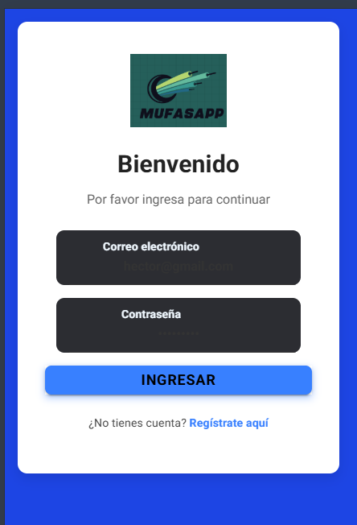
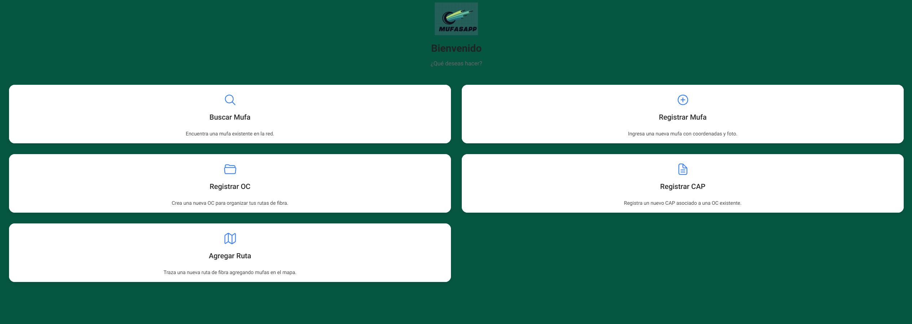
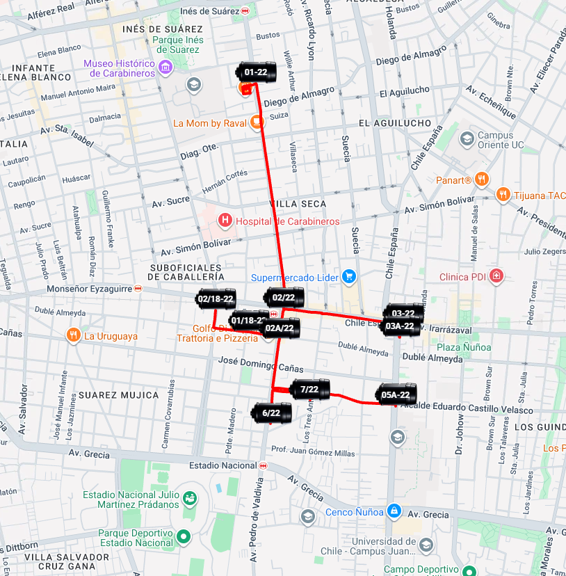
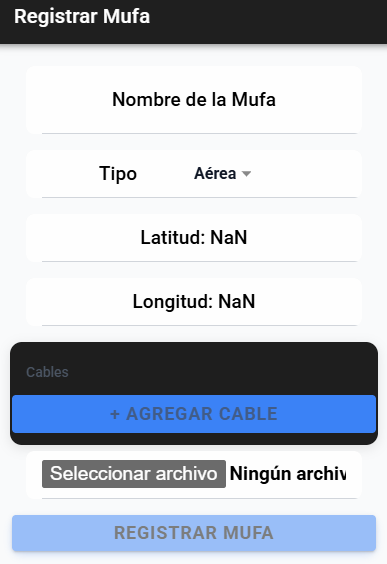
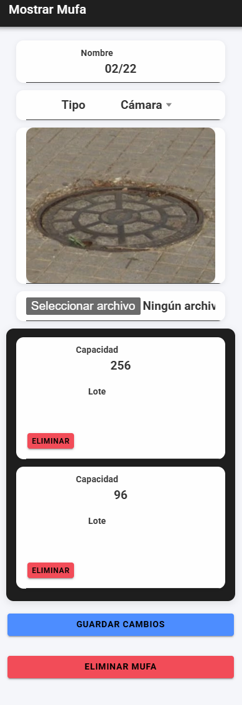
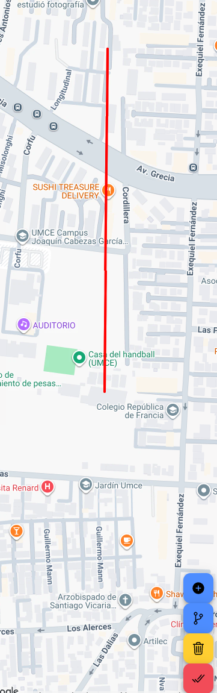
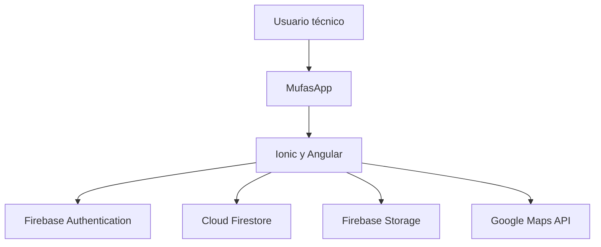
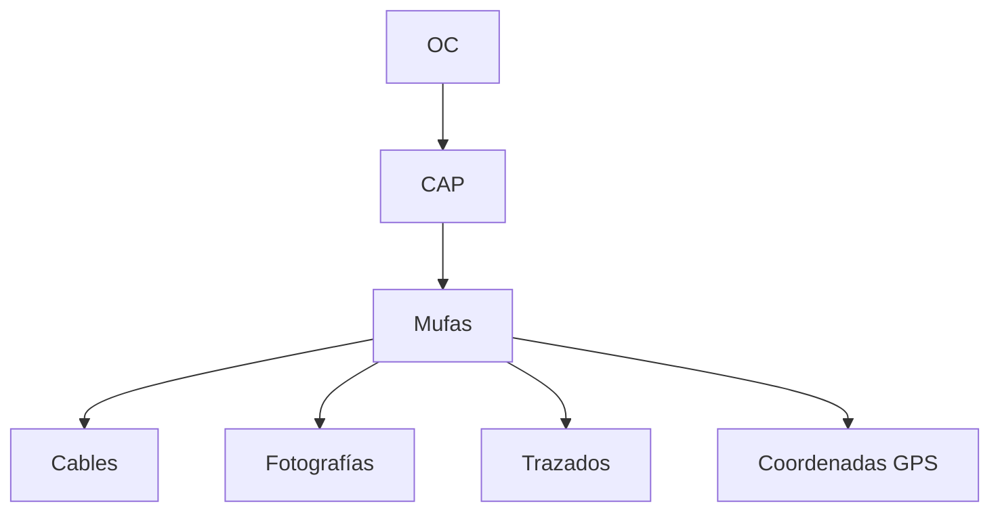

# mufasApp
Aplicación para localización de nodos de fibra óptica


<div align="center">


# 🌐 MufasApp

### Sistema de gestión y geolocalización de infraestructura de fibra óptica


</div>

---

## 📖 Descripción del proyecto

MufasApp es una aplicación desarrollada para optimizar la gestión, localización y registro de infraestructura de fibra óptica en el sector de las telecomunicaciones.

El proyecto nace a partir de las dificultades que enfrentan los técnicos fusionadores al localizar mufas, identificar CAP y conocer los recorridos de los cables de fibra óptica durante sus trabajos en terreno.

La aplicación permite centralizar esta información mediante mapas interactivos, registros digitales y almacenamiento en la nube.

## 🎯 Objetivos

- Reducir los tiempos de búsqueda de infraestructura.
- Facilitar la ubicación geográfica de mufas.
- Digitalizar los registros técnicos.
- Mejorar la organización de la información.
- Optimizar el trabajo de las cuadrillas de telecomunicaciones.

## 🚀 Funcionalidades

- Autenticación y registro de usuarios.
- Registro y administración de OC.
- Registro y administración de CAP.
- Creación y edición de mufas.
- Geolocalización mediante Google Maps.
- Clasificación de mufas aéreas y de cámara.
- Registro de cables de fibra óptica.
- Carga y visualización de fotografías.
- Trazado manual de recorridos sobre el mapa.
- Almacenamiento de información en Firebase.

## 📱 Capturas de pantalla

<div align="center">

| Inicio de sesión | Menú principal | Mapa interactivo |
|:---:|:---:|:---:|
|  |  |  |

| Registro de mufa | Detalle de mufa | Trazado de rutas |
|:---:|:---:|:---:|
|  |  |  |

</div>

## 🛠️ Tecnologías utilizadas

| Tecnología | Función |
|---|---|
| Ionic Framework | Desarrollo de interfaces multiplataforma |
| Angular | Arquitectura y lógica de la aplicación |
| TypeScript | Lenguaje de programación |
| Firebase Authentication | Autenticación de usuarios |
| Cloud Firestore | Base de datos NoSQL |
| Firebase Storage | Almacenamiento de imágenes |
| Google Maps API | Mapas y geolocalización |
| Git y GitHub | Control de versiones |

## 🏗️ Arquitectura del sistema



## 🗄️ Estructura de datos



## 📂 Estructura del proyecto

```text
mufasApp/
├── docs/
│   └── images/
├── src/
│   ├── app/
│   │   ├── mapa-mufas/
│   │   ├── models/
│   │   ├── pages/
│   │   ├── services/
│   │   └── firebase.config.ts
│   └── assets/
├── angular.json
├── ionic.config.json
├── package.json
└── README.md
```

## ⚙️ Instalación y ejecución

### Requisitos

- Node.js compatible con la versión de Angular.
- NPM.
- Ionic CLI.
- Git.
- Proyecto Firebase configurado.
- Google Maps API configurada.

### Clonar el repositorio

```bash
git clone https://github.com/RodrigoLeal30/mufasApp.git
cd mufasApp
```

### Instalar Ionic CLI

```bash
npm install -g @ionic/cli
```

### Instalar dependencias

```bash
npm ci
```

### Ejecutar la aplicación

```bash
ionic serve
```

La aplicación estará disponible en:

http://localhost:8100

## 🔐 Seguridad

El sistema utiliza Firebase Authentication para gestionar el acceso de los usuarios.

Las credenciales privadas no deben almacenarse en el repositorio. Se deben configurar reglas de seguridad en Firebase y restricciones para las claves de Google Maps antes de utilizar la aplicación en producción.

## 📈 Mejoras futuras

- Funcionamiento sin conexión a internet.
- Exportación de informes técnicos.
- Gestión de roles y permisos.
- Historial de modificaciones.
- Dashboard de indicadores.
- Notificaciones de trabajos en terreno.
- Optimización de rutas de trabajo.

## 👨‍💻 Autor

**Rodrigo Leal Agüero**

- Ingeniería de Ejecución en Informática.
- Instituto Profesional AIEP.
- Chile, 2026.
- GitHub: [RodrigoLeal30](https://github.com/RodrigoLeal30)

---

<div align="center">

**MufasApp — Tecnología al servicio de las telecomunicaciones.**

Desarrollado con Ionic, Angular y Firebase.

</div>
